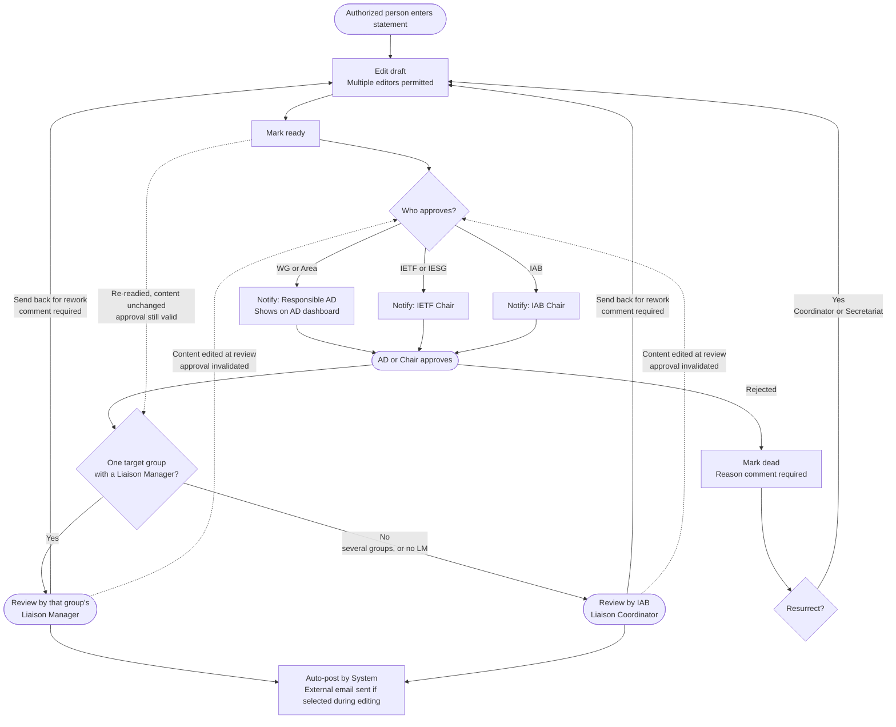
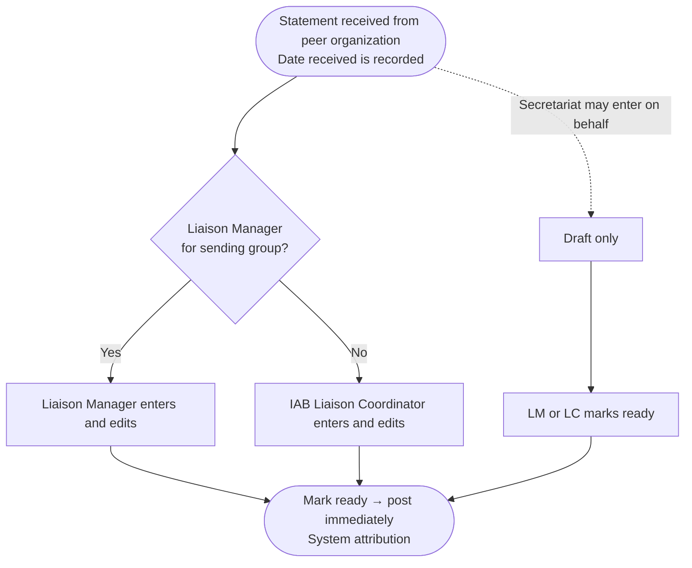

# IETF Datatracker Liaison Statement Tool — Reimplementation

[!WARNING]
This is currently an experimental repository to discuss whether restructuring the issues from the repositories mentioned below in this way is useful. Should we pursue this path, this repo will be deleted and rebuilt based on feedback on improving its usefulness. This reorganization was constructed with the help of Claude.

---

This repository tracks the design and implementation of a **reimplemented** liaison statement
management tool for the IETF datatracker. It supersedes
[liaison-tooling-2025a](https://github.com/ietf-tools/liaison-tooling-2025a), which served
as the initial requirements discussion space.

Issues in this repository are organized by feature area and contain implementation
requirements, design rationale, and attribution to upstream sources (existing datatracker
issues, liaison-tooling-2025a issues, and RFC 4052bis / RFC 4053bis).

> **Note:** All references to "RFC 4052bis" and "RFC 4053bis" in this repository will be
> updated to the assigned RFC numbers once the documents are published.

## Scope: a reimplementation, not a series of edits

The liaison application is being **rebuilt**, not patched. The issues here describe the
behaviour of the new application. They are not a literal edit plan against the current
`ietf/liaisons` code, and they do not carry `file.py:line` instructions.

The current implementation still matters in three ways, and issues say which applies:

1. **As the source of a requirement** — many requirements exist because of how the current
   tool behaves (or misbehaves). Those origins are recorded.
2. **As data to be migrated** — every existing statement, attachment, event, and external
   group record must land in the new schema with its history intact.
3. **As a compatibility surface** — public statement URLs, attachment URLs, and `/api/v1`
   consumers outlive the rewrite.

The phasing, migration, cutover, and validation work is described in the
[Implementation Plan](proposed-implementation-plan.md).

Two structural changes distinguish this reimplementation from the current tool:

- **External organizations are no longer modelled as `Group` records.** The liaison
  application owns purpose-built models for peer organizations, their groups, our formal
  liaison relationships with them, and the appointments that go with those relationships.
  See [Peer Organizations and Liaison Relationships](#peer-organizations-and-liaison-relationships).
- **Liaison Manager authority is answered by the liaison application**, from those appointment
  records, rather than by datatracker `Role` rows on external groups. The IAB Liaison
  Coordinator role does **not** move: it stays a `Role` in the `iab` group, because it is a
  responsibility of an IAB member held for the IAB as a whole rather than something tied to an
  individual peer organization.

---

## Workflow Overview

Liaison statements follow different paths depending on direction (incoming vs. outgoing).

### Outgoing Liaison Statements

**Notes:**

- **Targeting:** an outgoing statement is addressed to **exactly one peer organization** and
  to **one or more groups within that organization** (ISSUE-25). Reaching two organizations
  means two statements. Wider distribution before sending is done by adding addresses to
  From-Contact or To-Contact; there is no separate CC field (ISSUE-20).
  This is a constraint on what can be *created*, not a limit of the model: statements in the
  existing record that address more than one organization migrate intact and display correctly,
  and are reviewed by an IAB Liaison Coordinator like any multi-group statement.
- Drafting ends with a button labelled **"Mark ready"**, which sends the statement to its
  approvers. Text beside the button names those approvers. For incoming statements the same
  button posts the statement immediately, and the text says so (ISSUE-10).
- Approval is the first step. Review happens **after** approval — never in parallel
  (ISSUE-9, ISSUE-7).
- **Who reviews** (ISSUE-7):
  - **One target group that has a Liaison Manager** → that Liaison Manager reviews.
  - **More than one target group** → an IAB Liaison Coordinator reviews, **even when every
    target group has the same Liaison Manager**. The Coordinator is expected to coordinate
    with the Liaison Managers before completing the review; **the tool is not involved in
    that coordination** and records only the Coordinator's single review.
  - **No Liaison Manager for the target group** → an IAB Liaison Coordinator reviews.
  - A Coordinator may also review on a Liaison Manager's behalf in the single-group case.
  - **No workflow path requires more than one review** of the same statement.
  - Letting the Liaison Manager review a multi-group statement when all target groups share
    the same manager is a candidate simplification once there is experience with the new
    system; it is deliberately not in this design.
- **The Liaison Managers of every target group are notified as the statement progresses**
  (marked ready, approved, reviewed, posted), whether or not they are the reviewer
  (ISSUE-28).
- **A reviewer cannot reject a statement.** The only negative outcome available to a reviewer
  is **send back for rework**, which returns the statement to `draft` with a **mandatory
  comment** explaining what needs doing (ISSUE-12). A reviewer has no path to `dead`.
  Abandoning a sent-back statement is the editors' decision (or a Coordinator's / the
  Secretariat's, who may mark any statement dead).
- **An approver may still reject.** An AD or Chair who will not approve marks the statement
  `dead` with a mandatory reason (ISSUE-11).
- **Content edits after approval invalidate the approval** (ISSUE-13). If the title, body,
  purpose, deadline, attachments, or the IETF or peer group sets
  change after an approval is recorded, the statement must be approved again before it can be
  reviewed and posted. Editing the **addressing fields** (From-Contact, From-Liaison-Contact,
  To-Contact, To-Liaison-Contact) does **not** invalidate approval — the approver and the
  reviewer may adjust addresses in place, constrained only to syntactically valid addresses.
  *This requirement may be relaxed once there is experience with the new system; it is
  recorded as a deliberate starting point, not a permanent rule.*
- The approval and review screens highlight how each addressing field differs from its
  initial population (ISSUE-9, ISSUE-7).
- IAB Liaison Coordinators and Secretariat may record the approval action on behalf of an AD
  or Chair when approval was obtained out of band; a mandatory comment naming the actual
  approver is required. More generally, the Secretariat, IAB Chair, and Liaison Coordinators
  may act on behalf of any role holder, capturing who they act for (ISSUE-18).
- Auto-posting is attributed to the `(System)` user, not the approver or reviewer.
- **Pending approvals are surfaced, not just emailed** — an AD's pending liaison approvals
  show on the existing AD dashboard view alongside their document work. The IETF Chair and the
  IAB Chair have no dashboard of their own, so theirs appear in a pending-approval list inside
  the liaison application, as do the statements awaiting a Liaison Manager's or Coordinator's
  review (ISSUE-19).
- **In-flight work is visible too.** Each AD, Chair, Liaison Manager, Coordinator, and the
  Secretariat has an in-flight view in the liaison application. It lists every draft or pending
  statement relevant to their role, with who it is waiting on, and puts the items they owe
  first. The AD dashboard links to it (ISSUE-19).
- Statements marked dead are visible in the web application only to Liaison Coordinators
  and Secretariat. Dead statements are excluded from `/api/v1`. If the statement was once
  posted, its public URL displays "This statement has been removed" and the reason, rather than
  a 404.
- Liaison Coordinators and Secretariat can resurrect a dead statement to `draft`.
- Approval authority by originating group:
  - WG / Area → responsible AD(s)
  - IETF / IESG → IETF Chair
  - IAB → IAB Chair
- RFC 4053bis §4.2 requires that outgoing statements clearly indicate their consensus level.
  This is a content responsibility of the statement preparers and approvers; the tool does
  not enforce or track it.

**Correcting a posted outgoing statement:** a posted outgoing statement is never edited in
place. A correction is entered as a **new statement** that goes through approval again; it may
reference the original in prose, but the tool records no "replaces" relationship (ISSUE-17).

### Incoming Liaison Statements

**Notes:**

- Incoming statements require **no AD approval** and **no second-person review**. The Liaison
  Manager for the sending group enters the statement if one exists; otherwise an IAB Liaison
  Coordinator enters it.
- The same LM (or LC) who enters the statement marks it ready, which posts it immediately.
  There is explicitly no gate in which a coordinator reviews a manager's statement (or vice
  versa).
- **The date the statement was received is recorded separately from the date it was entered
  into the datatracker** (ISSUE-14). Entering a statement that was received weeks or months
  earlier is an expected, supported case: the person entering it sets the received date, and
  the statement is displayed and ordered by that date. When the statement was recorded in the
  datatracker is captured in its history, not in the ordering.
- **The address the statement was received from is recorded** as its From-Liaison-Contact,
  so any reply can be sent there. The IETF address it arrived through (`liaison-coordination@iab.org`
  or the Liaison Manager's alias) is recorded as its To-Liaison-Contact ([Contact
  Fields](#contact-fields), ISSUE-20).
- The Secretariat may enter a statement **on behalf** of an LM/LC, but only into a **draft**;
  an LM or LC must then mark it ready. The Secretariat cannot both enter and post the same
  statement (ISSUE-8).
- If an IAB Liaison Coordinator is also the Liaison Manager for the sending group, the tool
  records the action in the **Liaison Manager** role (ISSUE-15).
- All postings are attributed to the `(System)` user.
- **Correcting a posted incoming statement:** the Liaison Manager (or a Coordinator) corrects
  it in place. The correction emails the original parties (and any new ones) and records a
  history comment, both carrying the corrector's summary of the change (ISSUE-17).
- Follow-up on a received statement — including sending any response — is the responsibility
  of the responsible Liaison Manager, or an IAB Liaison Coordinator where no Liaison Manager
  is responsible. On a "For Action" statement the person who recorded it is the **assignee**
  by default (RFC 4053bis §3.1). The Liaison Manager or a Coordinator can reassign it, for
  example to a WG chair or AD. The assignee receives deadline reminders, can mark action
  taken, and sees the open action in their work view (ISSUE-24).

---

## Display and Ordering of Statements

The date a statement is *shown with* and *ordered by* depends on its direction (ISSUE-14):

| Direction | Displayed and ordered by | Recorded where |
|-----------|--------------------------|----------------|
| Incoming | **Date received** — when the IETF received it from the peer organization | A field on the statement, set by the person entering it |
| Outgoing | **Posted date** — when the tool posted and sent it | Set by the tool at posting |

The date a statement was **recorded in the datatracker** is always available in its history,
for both directions. It is never the sort key and is not the date shown in listings.

This makes back-entry a first-class case: an incoming statement received in the past but not
yet recorded is entered with its true received date and sorts into place accordingly, rather
than appearing as though it arrived on the day someone typed it in.

**Incoming and outgoing statements are never mixed in one listing table** (ISSUE-14). Their
dates mean different things, their useful columns differ, and their workflows differ. A page
that shows both, whether the general list, an organization's page, search results, or someone's
in-flight view, shows **one table per direction**, each with its own columns and sort date.
The only place the directions appear together is a statement's **thread view** (the statement,
what it replies to, and its replies, in chronological order). There each entry is labelled by
direction with a label or icon and colour, never colour alone. Whether the two tables sit on
one page or on separate pages is left to user testing (see the
[Implementation Plan](proposed-implementation-plan.md) §6).

---

## Peer Organizations and Liaison Relationships

The current tool models external SDOs as datatracker `Group` records (`type=sdo`) and
liaison manager appointments as `Role` rows on those groups. **The reimplementation does not.**
The liaison application owns purpose-built models for this domain, and the redesign includes
the UI for managing the objects in them (ISSUE-1, ISSUE-2).

The vocabulary follows RFC 4052bis, which speaks of *peer organizations* and *formal liaison
relationships*.

| Concept | What it holds |
|---------|---------------|
| **Peer organization** | An external SDO or other body (name, acronym, URL, status). The unit a statement is addressed to or received from. |
| **Peer group** | A body within a peer organization — an ITU-T Study Group, a 3GPP working group, etc. Carries the group's To-Contact list (ISSUE-22) and its liaison alias (ISSUE-31). |
| **Liaison relationship** | The IETF's formal relationship with a peer organization, per RFC 4052bis §2: how it was established, its scope, and its current status. Relationships may be informal (no relationship record needed) — statements can be exchanged without one. |
| **Appointment** | A person appointed as Liaison Manager for a relationship, with start and end dates and the appointing body. An appointment covers one or more of that organization's peer groups (by default all of them), and the Liaison Manager of a peer group is whoever holds a current appointment covering it. Appointments, not `Role` rows, are what the tool consults to answer "who is the Liaison Manager for this group?" |

**The IAB Liaison Coordinator is deliberately absent from that table.** It remains a datatracker
`Role` in the `iab` group, exactly as today. The coordinator role is a responsibility of an IAB
member, held for the IAB as a whole; it is not tied to any individual peer organization, so
there is nothing per-relationship to record about it. Only the Liaison Manager role — which
*is* per relationship — moves into the liaison application. The dividing line is scope: a role
held per peer organization belongs to the liaison application; a role held for the IETF or the
IAB as a whole stays a datatracker group role.

**Ending a formal relationship is not retiring an organization** (ISSUE-2). An informal
relationship needs no record: it exists because statements have been exchanged. Ending a
formal relationship end-dates it and its appointments. The organization and its groups stay
available, and statements continue with a Coordinator acting. An organization or group is
**retired** only when it ceases to exist or is restructured, such as at the end of an ITU-T
study period. Nothing referenced by a statement is ever deleted.

Consequences:

- **Authorization** comes from whichever source owns the role: Liaison Manager from the
  appointment records above, IAB Liaison Coordinator from the `iab` group role, and every other
  role from its existing datatracker role (ISSUE-1). "Authorized Individual" — the current role
  by which people from external SDOs could enter statements — does not exist in the new model;
  incoming statements are entered only by IETF-side roles (ISSUE-3).
- **IETF-side bodies are still `Group` records.** A statement's originating groups are WGs,
  Areas, the IETF, the IESG, or the IAB, and those remain datatracker groups with their
  existing roles. Only the external side moves.
- **Existing SDO `Group` rows, and the `liaiman` `Role` rows on them, are migrated into the new
  models and then retired** (ISSUE-39). `liaison_coordinator` roles in the `iab` group are left
  untouched by the migration. Statements already in the database keep pointing at the
  organizations and groups they were sent to, through migrated records.

---

## Roles

### Who can enter and edit liaison statements

| Role | Outgoing | Incoming |
|------|----------|----------|
| WG Chair | ✓ (for their WG) | — |
| WG Secretary | ✓ (for their WG) | — |
| Area Director | ✓ (for their area) | — |
| IETF Chair | ✓ | — |
| IAB Chair | ✓ | — |
| Liaison Manager | ✓ (for their relationship) | ✓ |
| IAB Liaison Coordinator | ✓ | ✓ |
| Secretariat | ✓ | ✓ |

WG Secretary has the same entry and edit permissions as WG Chair (scoped to their WG).
Incoming statements are entered only by IETF-side roles; there is no external-party entry
role in the new implementation (see ISSUE-3).

When entering a statement, the submitter records which role they are acting in (see ISSUE-15).

### Who can approve outgoing statements

Approval authority follows the originating group per RFC 4053bis §4.1.

| From group | Required approver |
|------------|-------------------|
| WG or Area | At least one responsible AD |
| IETF / IESG | IETF Chair |
| IAB | IAB Chair |

Pending liaison approvals are surfaced to the approver: an AD's are listed on the existing AD
dashboard view, alongside the rest of their queue. The IETF Chair and the IAB Chair have no
separate dashboard, so theirs are listed inside the liaison application. Every approver also
has an in-flight view of the statements they would approve, including drafts (ISSUE-19).

After approval, a **single review** gates posting — by the target group's Liaison Manager when
there is one target group, and by an IAB Liaison Coordinator when there is more than one
target group or the target group has no Liaison Manager. **No path requires more than one
review** (ISSUE-7). Liaison Managers and Coordinators are reviewers, not approvers.

### Who can review and post incoming statements

The Liaison Manager for the sending group, or an IAB Liaison Coordinator when the group has no
Liaison Manager. That single person's "mark ready" posts the statement; no second review is
required. The Secretariat may enter on behalf into a draft, but an LM/LC must mark it ready
(ISSUE-8).

### Who can send a statement back for rework

The reviewer of an outgoing statement — the Liaison Manager or IAB Liaison Coordinator
performing the review — returns it to `draft` with a mandatory comment (ISSUE-12). This is the
reviewer's only negative outcome; reviewers cannot mark a statement dead.

### Acting on behalf of another role

The Secretariat, the IAB Chair, and IAB Liaison Coordinators may perform any role-restricted
action on behalf of the role holder who would normally perform it, and the tool captures who
they are acting on behalf of (ISSUE-18). This includes recording an AD's or Chair's approval
obtained out of band; a mandatory comment names the actual approver.

### Who can mark "action taken"

Offered only on "For Action" statements. It can be marked by:
- the Liaison Manager of a relevant peer group (the sending group for incoming statements, any
  target group for outgoing);
- an IAB Liaison Coordinator;
- the Secretariat;
- the IAB Chair.

Others act on someone's behalf (ISSUE-18). Having an address in the statement's contact fields
grants no right to mark it (ISSUE-16).

A reply can also mark the original. The reply form has a "This reply completes the requested
action" checkbox, checked by default. Posting the reply with it checked marks the original
action taken, attributed to `(System)`. This works in both directions. An interim reply is
posted with the box unchecked, so the action stays open (ISSUE-33).

---

## Email Policy

- **From: header** on outgoing statement emails: `liaison-coordination@iab.org`
  (replaces `statements@ietf.org`).
- **Reply-To: header**: the statement's `From-Liaison-Contact` field, defaulting to
  `liaison-coordination@iab.org`.
- `statements@ietf.org` is retained as a receive-only alias for transition purposes only;
  it will not appear in any outgoing email and other SDOs should be directed to stop using it.
- `liaison-coordination@iab.org` is automatically CC'd on all statement emails and all
  approval request emails — **even when it is the From address** of the email (ISSUE-27).
- Responsible AD addresses are prepopulated into the correct statement contact fields as the
  statement is entered, rather than enforced as a separate always-CC rule (ISSUE-20).
- **Posting always sends email.** The only exception is a "Do not send email when posted"
  option. It is off by default, only Coordinators and the Secretariat can set it, and it
  requires a reason and a confirmation. It is for statements already distributed by other
  means, and the statement page then shows that it was not distributed by the datatracker.
  Internal notifications are sent regardless (ISSUE-30, ISSUE-28, ISSUE-32).
- Per-peer-group liaison aliases prepopulate the Liaison Manager address (see
  [Liaison Aliases](#liaison-aliases), ISSUE-31).

### When email is sent

**Every notification has the same base recipients.** For each statement there is a *standard
copy list*:
- the submitter;
- the Liaison Managers of the relevant peer groups, or the Coordinators where a group has no
  Liaison Manager;
- the person whose action triggered the message, plus whoever they acted for;
- `liaison-coordination@iab.org`.

Every notification goes to that list. Each message is also addressed **To** whoever must act
next or is its primary audience. Everyone else on the list is in Cc, and nobody receives two
copies (ISSUE-28, ISSUE-32).

**Outgoing statements:**

| Event | To | Cc |
|-------|----|----|
| Marked ready | Responsible ADs / Chair (the computed approvers) | Standard copy list |
| Approved | The reviewer (target group's LM, or a Coordinator) — review window now open | Standard copy list |
| Sent back for rework | Submitter and all draft editors, carrying the reviewer's mandatory comment | Standard copy list + Liaison Coordinators |
| Approval invalidated by a content edit | The approvers who must approve again | Standard copy list |
| Reviewed and posted | Submitter | Standard copy list |
| Marked dead | Submitter | Standard copy list + Liaison Coordinators |

Posting also sends the **statement itself** to the peer organization, using the header mapping
below. That email is separate from the internal "reviewed and posted" notification, and the
standard copy list is not added to it.

When anyone other than the submitter (an approver, reviewer, Coordinator, or the Secretariat)
has edited the statement since it was marked ready, the next notification lists every changed
field, content and addressing alike, with old and new values and who changed it (ISSUE-28).

**Incoming statements** (fewer events — ISSUE-32):

| Event | To | Cc |
|-------|----|----|
| Entered (incl. Secretariat-on-behalf draft) | The sending group's LM, or Coordinators where there is none | Standard copy list + Liaison Coordinators |
| Marked ready / posted | To-Contact recipients | Standard copy list |
| Corrected after posting | The original To-Contact recipients (plus any new ones), carrying the corrector's summary | Standard copy list |
| Marked dead | Submitter | Standard copy list + Liaison Coordinators |

For incoming statements, the posting notification *is* the distribution to the To-Contacts.
Nothing goes outside the IETF, so no separate internal notice is needed.

Deadline reminders are sent for "For Action" statements not yet marked "action taken", to the
parties responsible for follow-up: the responsible Liaison Manager (or the Coordinators where
there is none) and the statement's assignee (configurable schedule; ISSUE-29, ISSUE-24).

---

## Contact Fields

The tool implements the contact field model from RFC 4053bis §2.1. Two different things are
described below and are deliberately kept apart:

1. **What the statement records and displays** — the fields that are part of the liaison
   statement itself, visible on the statement page and in the API.
2. **What goes into the email headers** — how those statement fields are used when the tool
   emits mail. A statement field is not an email header, and several fields never appear as
   one.

### 1. Fields recorded in the statement

These are the addressing fields carried *in* the statement. All of them are shown on the
statement page.

| Statement field | RFC 4053bis name | Holds |
|-----------------|------------------|-------|
| `direction` | — | Outgoing (IETF → peer) or incoming (peer → IETF) |
| `ietf_groups` | From (outgoing) / To (incoming) | One or more IETF bodies: WG, Area, IETF, IESG, IAB |
| `peer_groups` | To (outgoing) / From (incoming) | One or more groups of a single peer organization, displayed with organization-qualified names such as "ITU-T SG15" (ISSUE-25) |
| `from_contact` | From-Contact | Contact address(es) of the originating body, including chairs, lists, responsible AD(s), and any additional experts or IETF participants who should be informed |
| `from_liaison_contact` | From-Liaison-Contact ("Send Reply To") | The address a reply should be sent to. Outgoing: a role or process address, not a personal one. Incoming: the address the statement was received from (required) |
| `to_contacts` | To-Contact | Contact address(es) at the receiving body, including any additional liaison-management contacts and experts there |
| `to_liaison_contact` | To-Liaison-Contact ("Send To") | Outgoing: the peer organization's central intake address, when it has one. Incoming: the IETF address the statement was received through (`liaison-coordination@iab.org` or a Liaison Manager alias) |

Groups are stored by kind (IETF or peer), not by side. The statement's direction decides which
set is From and which is To. No organization is stored or shown separately: it is derived from
the peer groups, and a statement to or from an organization as a whole uses that
organization's org-level peer group (ISSUE-1, ISSUE-20).

`from_liaison_contact` and `to_liaison_contact` are new. The group fields replace the current
tool's `from_groups` and `to_groups`. The rest have counterparts in the current tool.

**Legacy fields.** Four fields of the current tool are not part of the new schema. They are
never collected for new statements. Values on migrated statements are preserved and shown on
those statements only (ISSUE-39):

| Legacy field | Why it is not in the new schema | Use after migration |
|--------------|---------------------------------|---------------------|
| `technical_contacts` | Technical experts belong in From-Contact per RFC 4053bis (ISSUE-20) | Display only |
| `action_holder_contacts` | Replaced by a person-based assignee on incoming "For Action" statements (ISSUE-24) | Display only |
| `cc_contacts` | Additional IETF-side recipients go in From-Contact, and additional recipients at the receiving body go in To-Contact (RFC 4053bis §2.1, ISSUE-20) | Display only |
| `response_contacts` | Replaced by From-Liaison-Contact. Not backfilled | Display, and prepopulates a reply's To-Liaison-Contact when the original has no From-Liaison-Contact (ISSUE-33) |

**Replies are addressed from the original statement** (RFC 4053bis §2.1, ISSUE-33). A reply's
To-Liaison-Contact is prepopulated with the original's From-Liaison-Contact. It keeps the original's
IETF and peer groups with the direction reversed, so From and To swap, and its To-Contact comes
from the original's From-Contact. For a migrated original with no From-Liaison-Contact, the legacy response-contact
value is used. The submitter can change any prepopulated value.

### 2. How statement fields map to email headers

The same statement fields drive different headers depending on direction. Headers are
generated by the tool; they are not editable fields on the statement.

**Outgoing statement email** (the statement being sent to the peer organization):

| Email header | Value | Source |
|--------------|-------|--------|
| `From` | `liaison-coordination@iab.org` | Fixed by policy (ISSUE-26); not a statement field |
| `Reply-To` | The statement's `from_liaison_contact`, defaulting to `liaison-coordination@iab.org` | Statement field |
| `To` | The statement's `to_liaison_contact` if set; **otherwise** all `to_contacts` addresses | Statement field (either/or, never both) |
| `Cc` | All `from_contact` addresses, plus `liaison-coordination@iab.org` — always, even when it is also the `From` (ISSUE-27) | Statement fields + policy |

**Incoming statement notification** (mail the tool emits about a statement it received):

| Email header | Value | Source |
|--------------|-------|--------|
| `From` | `liaison-coordination@iab.org` | Fixed by policy; not a statement field |
| `To` | All `to_contacts` addresses | Statement field |
| `Cc` | The standard copy list: the submitter, the responsible Liaison Manager / Liaison Coordinator, the person who triggered the message (and whoever they acted for), and `liaison-coordination@iab.org` — always (ISSUE-27, ISSUE-32) | Role data + policy |

Note what is **not** carried into headers on the incoming side: the statement's `from_contact`
and `to_liaison_contact` are recorded and displayed on the statement but are **not** CC'd on
the notification.

---

## Liaison Aliases

The tool maintains one email **alias per peer group** (example: `unicode-liaison@ietf.org`).
The alias delivers to the group's **currently appointed Liaison Managers** and follows their
appointments automatically. Optional additional recipients can be added. Every recipient is a
datatracker person: an `Email` record belonging to a `Person`, never a list or an external
address. A group with no appointed Liaison Manager has its alias deliver to
`liaison-coordination@iab.org`. The datatracker coordinates with the mail system so the alias
actually delivers mail (ISSUE-31).

These aliases prepopulate address fields on the sending forms according to the acting role:

| Acting as | Prepopulated address |
|-----------|----------------------|
| Liaison Manager (group has one) | that group's liaison alias (e.g. `unicode-liaison@ietf.org`) |
| Liaison Coordinator | `liaison-coordination@iab.org` |
| IAB Chair | `iab-chair@iab.org` |
| IETF Chair | `chair@ietf.org` |

Role-address prepopulation ties into ISSUE-15 (the captured role's address populates the form)
and ISSUE-20 (contact-field population).

---

## Purpose Field

New statements must use one of the three RFC 4053bis-defined purpose values (ISSUE-23):

| Value | Use when |
|-------|----------|
| For Information | Informing the recipient; no response expected |
| For Action | Requesting the recipient do something, usually with a deadline |
| In Response | Responding to a received liaison statement |

"For Comment" and "Other" do not exist in the new implementation. Statements migrated with
those values retain them for display.

**Deadlines** (ISSUE-23):
- On **outgoing** statements, a deadline exists only for "For Action", and it is required
  there. A deadline means a response is expected by then, which is what For Action means
  (RFC 4053bis §2.2).
- On **incoming** statements, a deadline is recorded whenever the sender gave one, with any
  purpose, because the record reflects what was received. On a statement that is not "For
  Action" it is shown but drives nothing: no reminders and no "action taken". The entry form
  suggests For Action if the sender expects a response by that date.
- Migrated statements keep their deadlines whatever their purpose.

---

## Statement States

| State | Meaning | Publicly visible |
|-------|---------|-----------------|
| `draft` | Being edited; not yet marked ready. Also where a statement lands when a reviewer sends it back for rework | No — visible only to editors, approvers, the Liaison Managers of every relevant peer group, Coordinators, and Secretariat (ISSUE-10); excluded from `/api/v1` |
| `pending` | Outgoing only: marked ready, awaiting approval and then review | No |
| `posted` | Published | Yes |
| `dead` | Marked not to be posted; reason captured as a mandatory comment | No (Coordinators and Secretariat only); if previously posted, public URL shows "This statement has been removed" with the reason |

Statements and attachments are never hard-deleted, with one exception: a statement that no
notification has ever been sent about may be hard-deleted by an authorized editor (ISSUE-10).
In practice that means an outgoing draft that has never been marked ready. Incoming statements
are notified on entry, and sent-back statements have already been notified, so neither is
eligible.

The line is drawn at the first notification for three reasons:
- That is when the statement first leaves its editors. Copies then exist in mailboxes and in
  the `liaison-coordination@iab.org` archive.
- From then on its history can hold other people's actions.
- Marking it `dead` already hides it from everyone except Coordinators and the Secretariat.

Removing content for legal reasons or because it is abusive is an operational database action
by the Secretariat and tools team, outside the tool (ISSUE-11).

Coordinators and Secretariat can mark a statement `dead` at any point, and can resurrect a
dead statement to `draft`. Statements migrated in the current `not-approved` state become
`dead` (ISSUE-39).

### Approval and Review Gate Tracking

The `pending` state covers the entire in-review window for outgoing statements. Intermediate combinations (e.g., "approved but not yet reviewed") are **not**
represented as distinct state values. Instead, gate completion is tracked as events on the
statement:

**Outgoing statements** have two sequential gates, both required before auto-posting:

| Gate | Event | Prerequisite | Who records it |
|------|-------|-------------|----------------|
| AD / Chair approval | `approved` | — | The approver directly, or a Coordinator/Secretariat recording out-of-band approval with a mandatory comment naming the actual approver (ISSUE-18) |
| Review | `reviewed` | A currently valid `approved` event | One target group with an LM → that LM; more than one target group, or no LM → an IAB Liaison Coordinator (ISSUE-7) |

- The `approved` event must exist before the `reviewed` event is accepted — the two never run
  in parallel.
- Exactly one `reviewed` event is required, whatever the number of target groups.
- **An `approved` event is invalidated by a subsequent content edit** (ISSUE-13). The tool
  compares the statement's content fields — title, body, purpose, deadline, attachments,
  and the IETF and peer group sets — against their values at the time of
  approval. If they differ, the approval no longer counts and the statement must be approved
  again. Addressing-field edits do not invalidate approval.
- **Send back for rework** (ISSUE-12) records a `sent_back` event with a mandatory comment and
  returns the statement to `draft`. A prior approval is not erased by the send-back itself; it
  is invalidated only if the content actually changes before the statement is readied again.
- **The review triggers posting** (ISSUE-6). Completing the review, which is only possible while
  a valid `approved` event exists, immediately transitions the statement to `posted`,
  attributed to the `(System)` user. A review from before the current approval never counts.
  Recording an approval never posts a statement by itself.

**Incoming statements** have a single step, taken by the person who marks the statement ready:

| Gate | Event | Who records it |
|------|-------|----------------|
| Review | `reviewed` | The Liaison Manager for the sending group, or — when the group has no manager — an IAB Liaison Coordinator acting in that role |

Marking an incoming statement ready records its `reviewed` event and posts it immediately,
straight from `draft` (ISSUE-6, ISSUE-8). Incoming statements never sit in `pending`.

This design avoids multiplying state values into a combinatorial matrix and keeps all
attribution in the event log.

---

## Attachment Policy

- Attachments are stored in the datatracker blobstore and served by the datatracker
  (formats: PDF, HTML, plain text; see RFC 4053bis §2.3), with the legacy
  `www.ietf.org/lib/dt/documents/LIAISON/` paths redirecting (ISSUE-37).
- An attachment is part of the statement's content. Adding or removing one follows the same
  rules as any other change (ISSUE-34):
  - **Before posting**, it is ordinary editing. After approval it is a content change and
    invalidates the approval (ISSUE-13).
  - **Posted incoming**, it is allowed only as a correction, when the record does not match
    what was received (ISSUE-17). A file the sender issues later is a new incoming statement.
  - **Posted outgoing**, it is never allowed. Additional or different material is a new
    statement. The exception is a statement that was not sent by the tool (ISSUE-30): it is
    corrected like an incoming statement, to match what was actually sent.
- Attachments are never hard-deleted. Removal hides the file from public view and the API
  while preserving the record.
- **Safety exception:** on any posted statement, a Liaison Coordinator or the Secretariat can
  hide an attachment that must not stay public (malware, legal reasons), with a mandatory
  reason. A public notice with that reason replaces the file. This is an **operational
  safeguard**, not a liaison-process step: it is never a way to correct or withdraw what a
  statement says. Permanent removal is an operational action outside the tool.
- Other roles act through the act-on-behalf mechanism (ISSUE-18).

---

## Errors in Posted Statements

**Wrong content:**

- *Incoming:* "wrong" means **the record does not match what was received**, for example a
  transcription error, a wrong attachment, a wrong date, or wrong contacts. The Liaison
  Manager (or a Coordinator) corrects the posted statement **in place**. The correction emails
  the original parties (and any new ones) and records a history comment, both carrying the
  corrector's summary of the change (ISSUE-17). A **revised version issued by the
  sender** (Rev.1, corrigendum) is not a correction. It is entered as a new incoming statement.
- *Outgoing:* "wrong" means **the IETF should have said something else**. The statement is
  **not** edited in place, not even for a typo. A correction is entered as a **new statement**
  that goes through approval again, optionally referencing the original in prose. The tool
  records no "replaces" relationship (ISSUE-17). **Exception:** an outgoing statement posted
  with "Do not send email when posted" set was sent by other means. If its record does not
  match what was actually sent, it is corrected in place like an incoming statement
  (ISSUE-17, ISSUE-30).

**Should not have been sent:** A Liaison Coordinator marks the statement `dead` with a
mandatory reason comment. A statement in the `dead` state is visible only to Liaison
Coordinators and Secretariat and is excluded from `/api/v1`. Because the statement was
once posted, its public URL displays "This statement has been removed" and the reason, rather
than a 404.

---

## Implementation

Phasing, the new application's shape, data migration, cutover, and the user testing that
settles the open questions are described in the
[Implementation Plan](proposed-implementation-plan.md).
